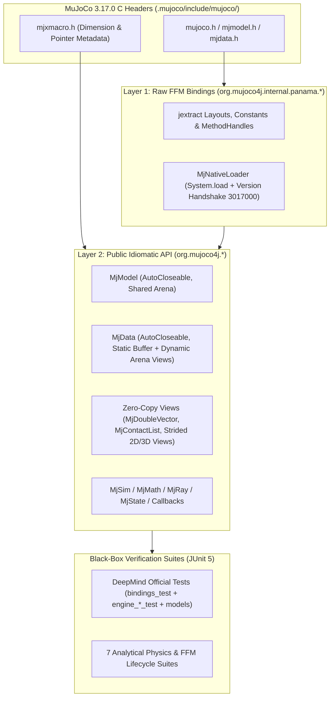

# mujoco4j — Java 25 FFM Architecture & Implementation Plan (v4 — Final Verified Against MuJoCo 3.17.0)

A pure-Java binding and idiomatic physics simulation library for **MuJoCo 3.17.0** (`mjVERSION_HEADER = 3017000`) built on **Java 25 LTS Foreign Function & Memory (FFM) API (`java.lang.foreign`)**, **Maven**, and **JBang**.

> [!IMPORTANT]
> **Design Goal:** Provide near-zero-overhead access to the MuJoCo C engine from Java 25 without JNI/C++ glue code, backed by **Google DeepMind's official `bindings_test.py` and `test/engine/` test suites** plus our analytical physics and FFM memory-safety black-box test suites.

---

## 1. Installed Native Baseline (`D:\mujoco4j\.mujoco`)

We have downloaded and extracted the official **MuJoCo 3.17.0 Windows x86_64** distribution and DeepMind's official test suites into `D:\mujoco4j\.mujoco\`:
- **Native Engine:** `.mujoco/bin/mujoco.dll` (`mjVERSION_HEADER = 3017000`)
- **C Headers:** `.mujoco/include/mujoco/` (`mujoco.h`, `mjmodel.h`, `mjdata.h`, `mjxmacro.h`, `mjspec.h`, `mjvisualize.h`, `mjrender.h`, `mjplugin.h`, `mjtype.h`)
- **Official Benchmark Models:** `.mujoco/model/` (`humanoid/humanoid.xml`, `car/car.xml`, `slider_crank/slider_crank.xml`, `tendon_arm/`, `flex/`, `mug/`, `plugin/`, etc.)
- **Official DeepMind Tests:** `.mujoco/deepmind-tests/` (`bindings_test.py`, `specs_test.py`, `rollout_test.py`, `engine_forward_test.cc`, `engine_support_test.cc`, `engine_sensor_test.cc`)

---

## 2. System Architecture & Version-Proof Code Generation

### Critical MuJoCo 3.17.0 C ABI & FFM Rules Enforced in Layer 1 & Layer 2
1. **Hermetic `jextract` Execution:** `SetupToolchain.java` provides minimal CRT shim headers (`stdlib.h`, `math.h`) if a full Windows C++ SDK is not installed globally, and filters extracted symbols to MuJoCo's `mj*` / `mju_*` / `mjd_*` / `mjv_*` / `mjr_*` namespace.
2. **64-bit `mjtSize` (`int64_t`) vs. 32-bit `int`:** In MuJoCo 3.17.0, all 78 size fields in `mjModel` (`nq`, `nv`, `nu`, `nactuator`, `nout`, `nbody`, `nbuffer`, `narena`) are `int64_t` (`long`), whereas dynamic counts in `mjData` (`ncon`, `nefc`, `nJ`, `nisland`) are 32-bit `int`.
3. **MIMO Actuator Dimensions (`nactuator` vs. `nu` vs. `nout`):** Sizes `d->ctrl` and `m->actuator_ctrlrange` by `nu`, actuator metadata by `nactuator`, and `d->actuator_force`, `d->actuator_length`, `d->actuator_velocity`, `m->actuator_gear` by `nout`.
4. **Two Memory Regions in `mjData` (`d->buffer` vs. `d->arena`):**
   - `MJDATA_POINTERS` (`qpos`, `qvel`, `act`, `ctrl`, `xpos`, `xquat`, `sensordata`, `qfrc_constraint`) reside in `d->buffer` with fixed addresses for the life of `MjData`.
   - `MJDATA_ARENA_POINTERS` (`d->contact`, `d->efc_type`, `d->efc_id`, `d->efc_J`, `d->efc_force`, `d->tendon_efcadr`) reside in `d->arena`: they are `NULL` when `ncon == 0` / `nefc == 0` and change base address and length on every `mj_step` / `mj_forward`. Therefore, `data.contacts()` (`MjContactList`) and `efc*` views resolve `d->contact`, `d->ncon`, and `d->nefc` dynamically on every access.
5. **`mj_readCtrl` & `mj_readSensor` Return-Pointer Handling:** When `interp == 0` (zero-order hold), MuJoCo returns a non-NULL `const mjtNum*` into the history buffer without writing to `result`; when `interp != 0`, it interpolates into `result` and returns `NULL`. Layer 2 copies from the returned pointer into `result` whenever the return pointer is non-NULL.
6. **FFM Upcall Callbacks (`mjcb_time`, `mjcb_sensor`, `mjcb_control`, `mju_user_warning`):**
   - Installs a default `System.nanoTime()` timer callback on startup (and restores it when `setTimeCallback(null)` is called) so `d->timer[...].duration` is populated by default.
   - Traps any Java exception thrown inside a user callback into a `ThreadLocal<Throwable>` and rethrows it on the Java side immediately after the C call completes (preventing fatal FFM upcall termination).
   - Maps native `mjModel*` and `mjData*` addresses via `WeakReference` tables so callbacks receive the exact Java `MjModel` and `MjData` wrapper instances without leaking memory.
7. **Precondition Validation Before C Downcalls:** Validates `pstack < narena`, state signatures (`0 <= sig < (1 << mjNSTATE)`), keyframe indices (`0 <= k < nkey`), actuator/sensor history dimensions, and Euler axis strings (`"xyzXYZ"`) in Java before invoking C downcalls so C `mju_error` (`exit()`) is never triggered.

---

## 3. Comprehensive Black-Box Testing Strategy (9 Suites)

All tests live in `src/test/java/org/mujoco4j/blackbox/` and test strictly through the public `org.mujoco4j.*` API.

### Suite 1: Official DeepMind Binding Suite (`DeepMindBindingsBlackBoxTest`)
Direct Java JUnit 5 port of DeepMind's `python/mujoco/bindings_test.py` (`MuJoCoBindingsTest`) using the canonical `TEST_XML`:
- **XML & Virtual Filesystem (`mjVFS`):** Loading `TEST_XML` from string/path, handling `<include>` asset name resolution via `MjVfs`, and rejecting repeated asset filenames.
- **Zero-Copy Array Views:** Reading `model.bodyPos()` (`[nbody x 3]`, verifying mocap body at `[42.0, 0, 42.0]`), mutating `data.qpos()`, and verifying that existing view references see mutations immediately without copying.
- **Named & Indexed Accessors:** `mj_name2id` & `mj_id2name` for bodies, geoms (`myplane`, `mybox`), joints (`myfree`, `myhinge`, `myball`), sites (`mysite`), actuators (`myactuator`), sensors (`myjointvel`, `myaccelerometer`), plus ragged `qpos` (`jnt_qposadr`), `cdof` (`jnt_dofadr`), and MIMO actuators (`nu`, `nactuator`, `nout`, `mju_sparse2dense`).
- **Sub-Struct Views & Mutation:** Reading and mutating `model.opt()` (`timestep`, `gravity`), `model.stat()` (`meanmass`, `extent`, `center`), and `model.vis()` (`fovy`, `shadowsize`), plus standalone `MjOption` creation and copying.
- **Copy Semantics:** `model.copy()` (`mj_copyModel`) and `data.copy()` (`mj_copyData`), verifying independent state and contact counts (`ncon == 2` vs `ncon == 4`).
- **Warnings & User Callbacks:** Setting `qpos[0] = Double.NaN`, calling `checkPos()`, and verifying both `data.warning(mjWARN_BADQPOS).number() == 1` and custom `mju_user_warning` FFM upcall callback invocation.
- **Exact Contact Stepping Test (`test_mj_step`):** Grabbing `contacts = data.contacts()` upfront while `ncon == 0`, dropping `mybox` by `displacement = 0.25` with `timestep = 2^-9` (`0.001953125`), verifying `ncon == 0` while `time < sqrt(2 * 0.25 / 9.81)`, then verifying `ncon == 4`, `nefc == 16`, and the 4 box corner contacts at `[-0.1, -0.1]`, `[0.1, -0.1]`, `[0.1, 0.1]`, `[-0.1, 0.1]`.
- **Integration State & Keyframes (`test_getsetstate`, `test_mj_setKeyframe`):** `mj_stateSize`, `mj_getState`, `mj_setState`, `mj_copyState` (`mjSTATE_INTEGRATION`), `mj_setKeyframe`, and `mj_resetDataKeyframe`, plus precondition error checks on invalid state signatures and keyframe indices.
- **Jacobians & Angular Momentum (`test_mj_jacSite`, `test_mj_angmomMat`):** Verifying `mj_jacSite` translational (`jacp`) and rotational (`jacr`) Jacobians on `mysite` and `mj_angmomMat` against `subtree_angmom`.
- **Pipeline Callbacks (`test_mjcb_time`, `test_mjcb_time_exception`, `test_mjcb_sensor`, `test_mjcb_control`):** Installing Java lambdas via FFM upcall stubs for custom timer, exception propagation from callback, custom user sensor (`mjSTAGE_VEL`), and control law callbacks, then restoring defaults cleanly.
- **Raycasting & Geometry Distance (`test_mj_ray`, `test_mju_ray_geom`, `test_mj_multi_ray`, `test_geom_distance`, `test_mj_inside_site_*`):** Single ray, analytical plane ray, multi-ray batching, geom-to-geom distance (`41.9`), and `mj_insideSite` for sphere, box, and mesh sites.
- **Finite-Difference Derivatives & Math Utilities:** `mjd_inverseFD`, `mjd_subQuat`, `mjd_quatIntegrate`, `mju_rotVecQuat`, banded Cholesky (`mju_dense2Band`, `mju_cholFactorBand`, `mju_cholSolveBand`), `mju_boxQP`, `mju_dense2sparse` / `mju_sparse2dense`, `mju_euler2Quat`, `mju_fill`, `mju_eye`, `mju_symmetrize`, `mju_clip`, `mju_mulVecMatVec`.
- **Actuator/Sensor Delay History & Polynomial Stiffness:** `mj_initCtrlHistory`, `mj_readCtrl` (ZOH and linear interpolation), `mj_initSensorHistory`, `mj_readSensor`, and polynomial spring stiffness (`jnt_stiffnesspoly` producing `qfrc_spring = -(k1*x + k2*x*|x| + k3*x^3)`).

### Suite 2: Official DeepMind Engine & Benchmark Models (`DeepMindEngineAndModelsBlackBoxTest`)
Ported from `engine_forward_test.cc`, `engine_support_test.cc`, `engine_sensor_test.cc`, and `.mujoco/model/`:
- **Official Benchmark Models:** Loads and steps `.mujoco/model/humanoid/humanoid.xml`, `car/car.xml`, `slider_crank/slider_crank.xml`, and `tendon_arm/arm26.xml`.
- **Forward vs. Inverse Dynamics Identity:** Steps `humanoid.xml` for 100 steps, runs `mj_forward` followed by `mj_inverse`, and verifies that `qfrc_inverse` recovers the exact applied + passive + actuator forces (`mjENBL_FWDINV` discrepancy $\approx 0$).

### Suite 3: Analytical Kinematics & Freejoint Gravity (`FreeFallBlackBoxTest`)
- Verifies `nq == 7`, `nv == 6`, free-fall kinematics $z(t) = z_0 + \frac{1}{2} g t^2$, $v_z(t) = g t$, $a_z = -9.81\text{ m/s}^2$, and quaternion normalization `[1, 0, 0, 0]`.

### Suite 4: Conservation of Mechanical Energy (`EnergyConservationBlackBoxTest`)
- Undamped pendulum with `<flag energy="enable"/>` and `integrator="RK4"` conserving $E_{\text{pos}} + E_{\text{vel}}$ over 5,000 steps.

### Suite 5: Contact Mechanics & Constraint Force Equilibrium (`ContactEquilibriumBlackBoxTest`)
- Sphere resting on ground plane with `qfrcConstraint[2] == m * g` ($24.525\text{ N}$).

### Suite 6: Actuators, Controls & Torque Dynamics (`ActuatorControlBlackBoxTest`)
- Newton-Euler motor acceleration $\alpha = \tau / I$ and PD position servo convergence.

### Suite 7: Forward Kinematics & Sensors (`KinematicsAndSensorsBlackBoxTest`)
- 2-link planar arm closed-form trigonometry $x = L_1\cos\theta_1 + L_2\cos(\theta_1+\theta_2), y = L_1\sin\theta_1 + L_2\sin(\theta_1+\theta_2)$ and proper acceleration $[0, 0, +9.81]\text{ m/s}^2$.

### Suite 8: Full Physics State Snapshot & Bitwise Replay Determinism (`DeterminismAndStateBlackBoxTest`)
- Bitwise-identical trajectory replay using full integration state (`mjSTATE_INTEGRATION` including `qacc_warmstart` and `act`).

### Suite 9: Memory Safety, Lifecycle & Hostile Input Verification (`SafetyAndLifecycleBlackBoxTest`)
- Malformed XML error capture (`MjException`), bounds checking (`IndexOutOfBoundsException`), use-after-close on `MjModel`, `MjData`, and cached `MjDoubleVector` views (`IllegalStateException`), parent-closed-before-child protection, and idempotent double-`close()`.

---

## 4. Phased Execution Roadmap

1. **Phase 1 — Toolchain, Maven Wrapper & Layer 1 (`jextract`):**
   - Set up `pom.xml` (Java 25) and Maven Wrapper (`mvnw` / `mvnw.cmd`).
   - Obtain `jextract` into `.tools/jextract/` and run `scripts/SetupToolchain.java` to generate Layer 1 (`org.mujoco4j.internal.panama`) from `.mujoco/include/mujoco/mujoco.h`.
   - Verify native library loading and version handshake (`3017000`).
2. **Phase 2 — Layer 2 Core Idiomatic API:**
   - Implement `MjNativeLoader`, `MjException`, `MjDoubleVector`, `MjIntVector`, `MjByteVector`, `MjOption`, `MjStatistic`, `MjVisual`, `MjWarningStat`, `MjTimerStat`, `MjContact`, `MjContactList`, `MjVfs`, `MjModel`, `MjData`, `MjSim`, `MjMath`, `MjRay`, `MjCallbacks`, and `MjvScene`.
3. **Phase 3 — Full Black-Box Verification (All 9 Suites):**
   - Implement and run all 9 black-box test suites (including `DeepMindBindingsBlackBoxTest` and `DeepMindEngineAndModelsBlackBoxTest`) via `./mvnw test` until 100% green.
4. **Phase 4 — JBang Standalone Example:**
   - Create `scripts/HelloMuJoCo.java` running a simulation of DeepMind's `humanoid.xml` via JBang.
