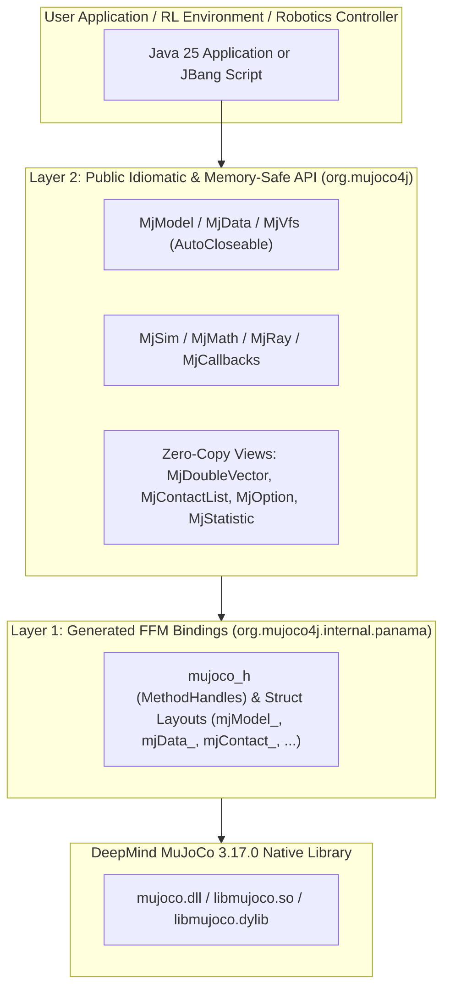

# mujoco4j

**Pure Java 25 LTS bindings and idiomatic physics simulation library for DeepMind MuJoCo 3.17.0 (`mjVERSION_HEADER = 3017000`)**

`mujoco4j` brings [DeepMind MuJoCo](https://mujoco.org/) to modern Java using the **Foreign Function & Memory (FFM) API (`java.lang.foreign` / Project Panama)** finalized in Java 22–25. It requires **zero JNI**, **zero C++ glue code**, and **zero native compilation**, while providing both raw C-level access and a rich, memory-safe, zero-copy Java API.

---

## Table of Contents

- [Why mujoco4j?](#why-mujoco4j)
- [Architecture](#architecture)
- [Prerequisites](#prerequisites)
- [Quick Start](#quick-start)
- [Usage Guide & Examples](#usage-guide--examples)
  - [1. Basic Simulation & Contact Inspection](#1-basic-simulation--contact-inspection)
  - [2. Zero-Copy State & Vector Access](#2-zero-copy-state--vector-access)
  - [3. Object Lookups (Bodies, Joints, Geoms, Actuators, Sensors)](#3-object-lookups-bodies-joints-geoms-actuators-sensors)
  - [4. PD / Motor Control & Custom Callbacks](#4-pd--motor-control--custom-callbacks)
  - [5. Virtual File System (In-Memory Assets & Meshes)](#5-virtual-file-system-in-memory-assets--meshes)
  - [6. Jacobians, Mass Matrix & Raycasting](#6-jacobians-mass-matrix--raycasting)
  - [7. 3D Math & Quaternion Utilities (`MjMath`)](#7-3d-math--quaternion-utilities-mjmath)
- [Public API Reference](#public-api-reference)
- [Test Suite & Verification (129 / 129 Passing)](#test-suite--verification-129--129-passing)
- [Project Layout](#project-layout)
- [License](#license)

---

## Why mujoco4j?

| Feature | Traditional JNI Bindings | `mujoco4j` (Java 25 FFM) |
| :--- | :--- | :--- |
| **Native Glue Code** | Requires C/C++ compiler & JNI shared libraries | **None** — pure Java `MethodHandle` downcalls & `MemorySegment` layouts |
| **Memory Safety** | Manual pointer tracking; JVM crashes on use-after-free | **Deterministic `Arena` & `AutoCloseable`** (`try-with-resources`), bounds-checked views |
| **Data Access Overhead** | Array copies across JNI boundary (`GetDoubleArrayElements`) | **Zero-copy `MemorySegment` views** (`MjDoubleVector`, `MjIntVector`, etc.) |
| **Callback Safety** | Uncaught Java exceptions in C callbacks crash the JVM | **Exception-safe trampolines** capture Java throwables and rethrow cleanly after step |
| **Single-File Scripting** | Complex classpath & native path setup | **First-class [JBang](https://www.jbang.dev/) support** (`jbang scripts/HelloMuJoCo.java`) |

---

## Architecture

`mujoco4j` is organized into two strictly separated layers:



1. **Layer 1 (`org.mujoco4j.internal.panama`)** — Auto-generated directly from MuJoCo 3.17.0's official C headers (`mujoco.h`, `mjmodel.h`, `mjdata.h`, `mjvisualize.h`, `mjspec.h`, etc.) using `jextract`.
2. **Layer 2 (`org.mujoco4j`)** — The public, safe Java API. User code never needs to touch raw `MemorySegment`s, `Arena`s, or C pointers.

---

## Prerequisites

- **Java 25 LTS** (or newer)
- **Maven 3.9+** (included via `./mvnw` / `.\mvnw.cmd`)
- **JBang** *(optional, for running standalone scripts in `scripts/`)*

---

## Quick Start

### Step 1: Clone the Repository

```powershell
git clone https://github.com/mehdizaidi104/mujoco4j.git
cd mujoco4j
```

### Step 2: Bootstrap Native MuJoCo 3.17.0 & Official Test Models

Run the self-contained bootstrap script using **JBang** (or `java`):

```powershell
jbang scripts/SetupToolchain.java
```

What this script does automatically:
- Downloads and verifies **DeepMind MuJoCo 3.17.0** into `.mujoco/` (`bin/mujoco.dll`, `include/mujoco/*.h`, and 91 official XML models in `.mujoco/model/`).
- Downloads DeepMind's official test suites (`bindings_test.py` and engine test XMLs) into `.mujoco/deepmind-tests/`.

### Step 3: Run the Test Suite

```powershell
.\mvnw.cmd test
```

Expected output:
```text
Tests run: 129, Failures: 0, Errors: 0, Skipped: 0
BUILD SUCCESS
```

### Step 4: Install Locally & Run a Standalone JBang Script

```powershell
.\mvnw.cmd install -DskipTests
jbang --fresh run scripts/HelloMuJoCo.java
```

---

## Usage Guide & Examples

### Maven Dependency

Once installed locally (`.\mvnw.cmd install`), add `mujoco4j` to any Maven project:

```xml
<dependency>
    <groupId>org.mujoco4j</groupId>
    <artifactId>mujoco4j</artifactId>
    <version>0.1.0-SNAPSHOT</version>
</dependency>
```

> **Note:** Remember to pass `--enable-native-access=ALL-UNNAMED` to the JVM at runtime so Java 25 permits FFM downcalls without warnings.

---

### 1. Basic Simulation & Contact Inspection

Both `MjModel` and `MjData` implement `AutoCloseable`. Wrapping them in `try-with-resources` guarantees that native `mj_deleteModel` and `mj_deleteData` are called deterministically when the block exits.

```java
import org.mujoco4j.*;

public class FallingBallDemo {
    public static void main(String[] args) {
        String xml = """
            <mujoco model="falling_ball">
              <option timestep="0.002" gravity="0 0 -9.81"/>
              <worldbody>
                <geom name="floor" type="plane" size="2 2 0.1"/>
                <body name="ball" pos="0 0 1.0">
                  <freejoint name="root"/>
                  <geom name="ball_geom" type="sphere" size="0.1" mass="1.0"/>
                </body>
              </worldbody>
            </mujoco>
            """;

        try (MjModel model = MjModel.loadFromXmlString(xml);
             MjData data = model.makeData()) {

            // Step 500 times (1.0 second of simulated time)
            for (int i = 0; i < 500; i++) {
                MjSim.step(model, data);
            }

            System.out.printf("Sim time: %.3f s%n", data.time());
            System.out.printf("Ball height (z): %.4f m%n", data.qpos().get(2));
            System.out.printf("Active contacts: %d%n", data.ncon());

            // Inspect active contacts via zero-copy MjContactList
            for (MjContact contact : data.contacts()) {
                double[] pos = contact.pos();
                System.out.printf("Contact dist=%.6f at (%.3f, %.3f, %.3f)%n",
                    contact.dist(), pos[0], pos[1], pos[2]);
            }
        }
    }
}
```

---

### 2. Zero-Copy State & Vector Access

`MjData` and `MjModel` expose simulation arrays as bounds-checked, zero-copy views (`MjDoubleVector`, `MjIntVector`, `MjFloatVector`, etc.) backed directly by MuJoCo's native memory:

```java
try (MjModel model = MjModel.loadFromXmlPath(Path.of(".mujoco/model/humanoid/humanoid.xml"));
     MjData data = model.makeData()) {

    // Read dimensions
    int nq = model.nq(); // Generalized positions (28)
    int nv = model.nv(); // Generalized velocities (27)
    int nu = model.nu(); // Actuators (21)

    // Mutate generalized positions & controls directly in native memory (zero copy)
    MjDoubleVector qpos = data.qpos();
    qpos.set(2, 1.40); // Set torso z-height

    // Or bulk copy to/from a Java double[]
    double[] ctrlValues = new double[nu];
    ctrlValues[0] = 0.25;
    data.ctrl().copyFrom(ctrlValues);

    // Compute forward kinematics & dynamics without advancing time
    MjSim.forward(model, data);

    // Read Cartesian body positions (nbody x 3)
    MjDoubleVector xpos = data.xpos();
    System.out.printf("Body 1 position: (%.3f, %.3f, %.3f)%n",
        xpos.get(1, 3, 0), xpos.get(1, 3, 1), xpos.get(1, 3, 2));
}
```

---

### 3. Object Lookups (Bodies, Joints, Geoms, Actuators, Sensors)

Translate between names defined in MJCF XML and integer IDs using `MjObjType`:

```java
int bodyId = model.name2id(MjObjType.BODY, "ball");
String bodyName = model.id2name(MjObjType.BODY, bodyId);

int geomId = model.name2id(MjObjType.GEOM, "floor");
int jointId = model.name2id(MjObjType.JOINT, "root");
```

---

### 4. PD / Motor Control & Custom Callbacks

Register Java lambdas as native MuJoCo callbacks (`mjcb_control`, `mjcb_passive`, `mjcb_time`, `mjcb_sensor`). If a callback throws a Java exception, `mujoco4j` catches it before the C stack unwinds and rethrows it cleanly on the calling Java thread:

```java
try (MjModel model = MjModel.loadFromXmlString(pendulumXml);
     MjData data = model.makeData()) {

    // Install a proportional-derivative (PD) controller callback
    MjCallbacks.setControlCallback((m, d) -> {
        double targetAngle = 0.5;
        double kp = 50.0, kd = 5.0;
        double error = targetAngle - d.qpos().get(0);
        double torque = kp * error - kd * d.qvel().get(0);
        d.ctrl().set(0, torque);
    });

    try {
        for (int i = 0; i < 1000; i++) {
            MjSim.step(model, data);
        }
    } finally {
        // Always reset global callbacks when done
        MjCallbacks.resetAllCallbacks();
    }
}
```

---

### 5. Virtual File System (In-Memory Assets & Meshes)

Load multi-file models (included XMLs, STL/OBJ meshes, heightfields) purely from memory without touching the disk using `MjVfs`:

```java
try (MjVfs vfs = new MjVfs()) {
    vfs.addFile("child.xml", "<mujoco><worldbody><geom type='sphere' size='0.1'/></worldbody></mujoco>");
    vfs.addFile("main.xml", "<mujoco><include file='child.xml'/></mujoco>");

    try (MjModel model = MjModel.loadFromVfs("main.xml", vfs);
         MjData data = model.makeData()) {
        MjSim.step(model, data);
    }
}
```

---

### 6. Jacobians, Mass Matrix & Raycasting

```java
// 1. Compute 3xNV translational and rotational Jacobians for a body
double[] jacp = new double[3 * model.nv()];
double[] jacr = new double[3 * model.nv()];
MjSim.jacBody(model, data, jacp, jacr, bodyId);

// 2. Convert sparse inertia matrix (qM) into a dense NV x NV matrix
double[] denseM = new double[model.nv() * model.nv()];
MjSim.fullM(model, data, denseM);

// 3. Cast a ray from (0, 0, 2) pointing straight down (0, 0, -1)
double[] pnt = {0.0, 0.0, 2.0};
double[] vec = {0.0, 0.0, -1.0};
MjRay.RayHit hit = MjRay.ray(model, data, pnt, vec);
System.out.printf("Ray hit geomId=%d at distance=%.4f m%n", hit.geomId(), hit.dist());
```

---

### 7. 3D Math & Quaternion Utilities (`MjMath`)

`MjMath` wraps MuJoCo's `mju_*` math routines for vectors, matrices, and quaternions:

```java
double[] quat = new double[4];
double[] axis = {0.0, 0.0, 1.0};
MjMath.axisAngle2Quat(quat, axis, Math.PI / 2.0); // 90 deg around Z

double[] vec = {1.0, 0.0, 0.0};
double[] rotated = new double[3];
MjMath.rotVecQuat(rotated, vec, quat); // -> (0.0, 1.0, 0.0)
```

---

## Public API Reference

| Class / Enum | Responsibility |
| :--- | :--- |
| **`MjModel`** | Immutable compiled model (`mjModel*`), XML/binary/VFS loading, dimensions (`nq`, `nv`, `nu`, `nbody`, `njnt`, `ngeom`, etc.), name/ID lookups, and model array views. |
| **`MjData`** | Mutable simulation state (`mjData*`), `qpos`, `qvel`, `act`, `ctrl`, `qfrc_applied`, `xfrc_applied`, `xpos`, `xquat`, `sensordata`, `contacts()`, `energyPos()`, `energyVel()`, warnings, timers, and solver stats. |
| **`MjSim`** | Core simulation pipeline (`step`, `step1`, `step2`, `forward`, `inverse`, `resetData`, `resetDataKeyframe`, `copyData`), state serialization (`stateSize`, `getState`, `setState`), Jacobians (`jac`, `jacBody`, `jacGeom`, `jacSite`), and inertia (`fullM`, `solveM`). |
| **`MjMath`** | 3D & N-dimensional vector/matrix math, quaternion operations (`mulQuat`, `rotVecQuat`, `axisAngle2Quat`, `quat2Mat`, `quat2Vel`, `mat2Quat`), and spatial transforms. |
| **`MjRay`** | Analytical raycasting (`ray`, `rayVec`, `rayGeom`, `rayMesh`). |
| **`MjCallbacks`** | Thread-safe & exception-safe custom callback registration (`mjcb_control`, `mjcb_passive`, `mjcb_time`, `mjcb_sensor`, `mjcb_act_dyn`, `mjcb_act_gain`, `mjcb_act_bias`, `mju_user_warning`). |
| **`MjVfs`** | Virtual File System (`mjVFS`) for in-memory model & asset loading. |
| **`MjOption` / `MjStatistic`** | Live views over `model.opt()` (timestep, gravity, wind, viscosity, integrator, disable/enable flags) and `model.stat()`. |
| **`MjContactList` / `MjContact`** | Iterable zero-copy views over active contacts (`dist`, `pos`, `frame`, `friction`, `geom1`, `geom2`, `H`). |
| **`MjDoubleVector` / `MjIntVector` / `MjFloatVector` / `MjLongVector` / `MjByteVector`** | Bounds-checked, zero-copy primitive array views over native `MemorySegment`s with 1D & 2D indexing (`get(row, cols, col)`). |
| **`MjvScene` / `MjvCamera` / `MjvOption` / `MjvPerturb` / `MjvFigure`** | Abstract visualization scene graph (`mjv_*`) for custom renderers. |

---

## Test Suite & Verification (129 / 129 Passing)

All tests in `src/test/java/org/mujoco4j/blackbox/` strictly test the public `org.mujoco4j.*` API without importing any internal `jextract` classes:

| Test Suite | Tests | What It Verifies |
| :--- | :---: | :--- |
| `DeepMindBindingsBlackBoxTest` | 21 | Java port of DeepMind's official `bindings_test.py` (VFS, array slicing, name/ID lookups, contacts, Jacobians, mass matrix, callbacks, exception propagation, raycasting, and `mju_*` math). |
| `DeepMindEngineAndModelsBlackBoxTest` | 97 | Compiles, steps, and checks finite state invariants across **all 91 official MuJoCo XML models** (humanoids, quadrupeds, shadow hand, flex/deformables, composites, adhesion, plugins) plus engine constraint & sensor tests. |
| `FreeFallBlackBoxTest` | 1 | Verifies exact ballistic trajectory $z(t) = z_0 - \frac{1}{2}g t^2$ and $v_z(t) = -g t$. |
| `EnergyConservationBlackBoxTest` | 1 | Verifies mechanical energy ($E_{pot} + E_{kin}$) conservation on an undamped double pendulum under RK4 integration (`< 1e-6` drift). |
| `ContactEquilibriumBlackBoxTest` | 1 | Verifies a sphere settling onto a plane reaches resting equilibrium at $z = r$ with normal contact force $F_z = m g$. |
| `ActuatorControlBlackBoxTest` | 2 | Verifies position/PD servo tracking and motor torque angular acceleration ($\alpha = \tau / I$). |
| `KinematicsAndSensorsBlackBoxTest` | 1 | Verifies 2-link planar arm forward kinematics (`site_xpos`), analytical `jacSite`, and `framepos` / `jointpos` / `jointvel` sensors. |
| `DeterminismAndStateBlackBoxTest` | 1 | Verifies bit-for-bit trajectory reproducibility when snapshot/restoring `MjState.PHYSICS`. |
| `SafetyAndLifecycleBlackBoxTest` | 4 | Verifies `IllegalStateException` on use-after-close, idempotent double `close()`, `IndexOutOfBoundsException` on vector views, and descriptive `MjException` on malformed XML. |

---

## Project Layout

```text
mujoco4j/
├── pom.xml                                  # Maven build config (Java 25, JUnit 5, jextract profile)
├── mvnw / mvnw.cmd                          # Maven Wrapper
├── scripts/
│   ├── SetupToolchain.java                  # Downloads MuJoCo 3.17.0 & official DeepMind test assets
│   └── HelloMuJoCo.java                     # Standalone JBang demo script
├── src/
│   ├── main/java/org/mujoco4j/
│   │   ├── MjModel.java, MjData.java, ...   # Layer 2: Public memory-safe Java 25 API (40 classes)
│   │   └── internal/panama/                 # Layer 1: jextract-generated FFM bindings (179 classes)
│   └── test/java/org/mujoco4j/blackbox/     # 9 Black-box test suites (129 tests)
└── .mujoco/                                 # (Git-ignored) Local MuJoCo 3.17.0 native distro & models
```

---

## License

Licensed under the [Apache License, Version 2.0](LICENSE) — the same license used by [DeepMind MuJoCo](https://github.com/google-deepmind/mujoco/blob/main/LICENSE).

